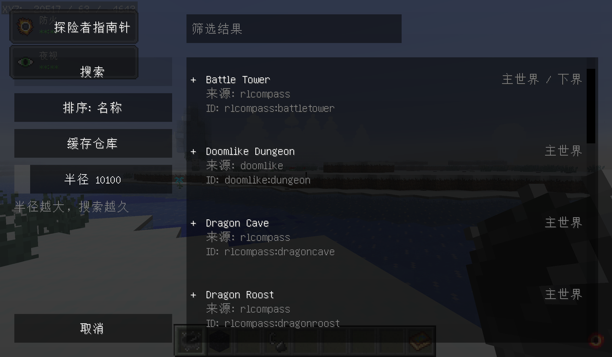

# RLCraft Explorer's Compass

专为 **RLCraft 1.12.2** 定制的结构定位指南针：在可配置半径内找到距离最近的结构，
连**从未生成过的区块**也能提前算出 Shivaxi 天空之城的候选坐标。

[](https://www.minecraft.net/)
[](https://files.minecraftforge.net/)
[](https://adoptium.net/)
[](https://www.curseforge.com/minecraft/modpacks/rlcraft)
[](LICENSE)

<p align="center">
  
</p>

<p align="center"><sub>结构选择界面：左侧是搜索 / 排序 / 缓存仓库 / 半径滑条，右侧列表标出每个结构的生成维度</sub></p>

## 这是什么

RLCraft 往 1.12.2 里塞进了两百多个模组，结构也大多来自模组：龙巢、恐怖生物地牢、Roguelike 地牢、
战斗高塔、Ruins、Recurrent Complex……而 1.12.2 **没有统一的结构注册表**，原版 `/locate`
和多数结构指南针都找不到它们。

这个模组为 RLCraft 里每一种生成机制单独写了适配器，统一注册到 `IStructureLocator`，
在可配置半径内按**距离最近优先**返回坐标：

- **常规结构**：直接读模组自己的坐标表、存档记录或位置文件，快且准。
- **没有位置记录的结构**（龙巢、龙穴）：扫描 region 文件里的特征方块，再做形状判定。
- **超稀有结构**（Shivaxi 天空之城）：复现 Recurrent Complex 的区块随机并做放置试算，
  **未生成的区块也能算**，并提前剔除会被拒绝的候选。
- **搜过的不再重复**：结果自动进「缓存仓库」，可标记已找到 / 未找到、可逐条删除。
- **一键传送**：开启作弊或 OP 后，仓库里点「传送」直达该坐标的地表，Y 由服务端重算，不会埋进方块。
- **维度标注**：列表里直接标出每类结构生成在哪个维度；维度不符时明确告知，而不是报「没找到」。

<details>
<summary>工作原理（四层定位策略）</summary>

1. **标准 `MapGenStructure` 适配器**
   通过反射从 `ChunkGeneratorOverworld` 提取生成器实例，调用其定位逻辑。
   覆盖 Better Mineshafts 这类替换原版生成器的模组。

2. **生成时缓存适配器**
   对 Ruins、Battle Towers、Doomlike Dungeons、Recurrent Complex 等非标准生成机制的模组，
   在世界生成时记录坐标到 `WorldSavedData`，搜索时直接查询缓存。

3. **模组专项适配器**
   对 Recurrent Complex 等有自身定位 API 的模组，优先调用其内部逻辑，无法调用时退回缓存方案。

4. **确定性重放 + 放置试算**（超稀有结构专用）
   只依赖 `worldSeed`、群系和模组自己的选择器，遍历未生成区块：
   - `ChunkGeneratorOverworld.populate` 的随机数是 `x*k + z*l ^ worldSeed`，已用运行时探针逐位比对确认；
   - Recurrent Complex 的类别迭代顺序来自 `HashMap` 身份哈希，逐会话不同，
     模组把它钉死成确定序（否则同一 chunk 在不同会话里会掷出不同类别）；
   - 命中后用 RC 自己的 `StructureGenerator.boundingBox()` 做**纯试算**（内部调 `Placer.place(...)`，
     返回 `DONT_GENERATE` 即拒绝），只读地形、不放方块，因此「预测到坐标但过去是空地」被提前过滤掉。

所有适配器统一实现 `IStructureLocator`，指南针汇总各适配器的候选坐标，按与玩家的距离排序，返回最近的一个。

</details>

## 下载与安装

| 项 | 要求 |
| --- | --- |
| Minecraft | 1.12.2 |
| Forge | 14.23.5.x |
| Java | 8 |
| 整合包 | RLCraft（本模组针对其结构模组集适配） |
| 模组版本 | `1.1.0` |
| 模组 ID | `rlcompass` |
| 作者 | tom500101 |

**安装**

1. 下载 [`rlcraft-explorers-compass-1.1.0.jar`](https://github.com/Tom500101/rlcraft-explorers-compass/releases/download/v1.1.0/rlcraft-explorers-compass-1.1.0.jar)
   （[全部发布](https://github.com/Tom500101/rlcraft-explorers-compass/releases)）；也可以按文末「开发与构建」
   自行编译，产物在 `build/libs/`。
2. 把 jar 放进整合包的 `mods/` 目录。
3. **客户端与服务端都要装**，且版本一致（原因见「多人游戏说明」）。
4. 启动游戏。首次启动会生成 `config/rlcompass.cfg`。

没有任何前置模组：没装某个结构模组时，列表里对应条目会自动隐藏。
升级只需替换 jar，配置文件新增项会自动补上；卸载删掉 jar 即可，
存档里的缓存与仓库数据（`data/`、`rlcompass/`）可留可删。

## 快速开始

### 1. 拿到指南针

按下面的有序配方合成（中间是原版指南针）：

```text
      [铁锭]
[铁锭] [指南针] [铁锭]
      [末影珍珠]
```

创造模式在**工具**（Tools）标签页；也可以直接给：

```mcfunction
/give @p rlcompass:explorers_compass
```

### 2. 右键打开结构选择界面

界面外观见上方截图：左侧是操作区，右侧是带维度标注的结构列表。三区响应式排布，
尺寸由窗口宽高推导，任何 GUI 缩放比例下都会自动重排。

| 控件 | 行为 |
| --- | --- |
| 筛选框 | 输入即筛选；`@minecraft` 这类 `@` 前缀按来源模组过滤 |
| 列表行 | 单击选中，双击直接搜索；选中行边框变金色；右侧标注生成维度 |
| 搜索 | 对选中结构发起搜索并关闭界面 |
| 排序 | 在「名称 / 来源」之间循环 |
| 仓库 | 打开缓存仓库（增删改查 + 三态） |
| **半径滑条** | 拖动调整 100–100000 格，步长 100；**松开鼠标即写回 `config/rlcompass.cfg`**（拖动过程不写盘） |
| 取消 | 关闭界面（`ESC` 亦可，输入框聚焦时也不会吞掉 ESC） |

滑条下方常驻一行「半径越大，搜索越久」；选中 Shivaxi 这类超稀有结构时会追加
「超稀有结构：建议半径 100000，搜索可能需要数分钟」，避免在默认半径下白等。

### 3. 看结果

- **命中**：目标常驻 HUD，显示方向箭头、距离与坐标（可在配置里关掉精确坐标）；
  目标会一直保留到你换维度。
- **没找到**：聊天栏说明是哪个结构没搜到，而不是让目标悄悄消失。
- **维度不符**：直接告诉你它生成在哪个维度，不会把「没去搜」说成「没找到」。
- 每次命中都会写进缓存仓库，下一次搜索自动跳过这个点。

### 4. 管理搜索记录

点「仓库」打开缓存仓库：按结构筛选，把条目改成 **未探索 / 已找到 / 未找到**，
或者逐条删除。只有删掉某一行，那个坐标才会重新参与搜索——这能避免在同一个空点上反复传送。

**传送**：开启作弊（或服务器 OP）后，每行右侧的「传送」按钮会把你送到该坐标**正上方的地表**。
Y 由服务端重新计算：从最高处往下找第一个「脚下是实心方块、头脚两格为空」的位置，
跳过树叶与原木，拒绝水面、岩浆、仙人掌、火焰和传送门；目标列不可用时会向周围 16 格找替代落点。
所以龙穴、地牢这类地下结构也不会把你埋进山体。

## 支持的结构

覆盖原版与 RLCraft 常用的结构模组，共 10 类结构：原版 6 类、Better Mineshafts、
Roguelike / Doomlike 地牢、Ruins、战斗高塔、Recurrent Complex、冰与火龙巢·龙穴、
恐怖生物地牢，以及超稀有的 Shivaxi 天空之城。

<details>
<summary><b>展开完整支持表（定位方式与实测数据）</b></summary>

| 来源 | 结构 | 定位方式 | 实测 / 备注 |
| --- | --- | --- | --- |
| 原版 Minecraft | 村庄、海底神殿、林地府邸、沙漠神殿、女巫小屋、要塞 | `MapGenLocator` 反射原版生成器 | 自测合计 221 ms |
| Better Mineshafts | 废弃矿井 | `MineshaftLocator` 有界搜索 | 8976 ms → **23 ms** |
| Roguelike Dungeons | 地牢（含主题变种） | 螺旋判定 `Dungeon.canSpawnInChunk` | 308 格 / 2 ms |
| Doomlike Dungeons | 地牢（含主题变种） | 螺旋判定 `isDungeonCenter` | 539 格 / 3 ms |
| Ruins | 遗迹 | 读模组位置文件（包围盒中心） | 命中率 100%，不靠方块检测 |
| Battle Towers | 战斗高塔 | 读 `WorldGenHandler.worldMap`；为空时回退存档里的 `BattletowerPositionsFile.txt` | 兼容 RLTweaker Consistent 模式 |
| Recurrent Complex | 全部已记录结构 | 反射 `WorldStructureGenerationData` | 实测 `(220,84,265)` / 3 ms |
| Ice and Fire | 龙巢 `rlcompass:dragonroost`<br>龙穴 `rlcompass:dragoncave` | `DragonRoostLocator` + region 扫描（12 位方块 ID）；用**宝藏深度**区分地面巢与地下穴 | 判出的龙穴与存档里 `AgingDisabled=1` 的龙实体坐标吻合 |
| Lycanites Mobs | 地牢 `rlcompass:lycanitesdungeon` | 优先反射 `ExtendedWorld.dungeons`，失败退回 region 扫描 | 存档内 6 条记录与扫描结果互证 |
| Recurrent Complex（超稀有） | Shivaxi 天空之城 `rlcompass:shivaxi` | 确定性重放 + RC 放置试算，可扫未生成区块 | 加入试算后 2/2、2/2 全部命中真城 |

</details>

- 完整 ID 与当前世界的可用列表用 `/rlcompass list` 查看。
- Antique Cities **不生成结构**（它只是 Antique Atlas 的地图标记插件），因此无需适配。
- 生成机制与探针结论见 [`docs/probe-result.md`](docs/probe-result.md)。探测器推翻了计划书的两条假设：
  1.12.2 里类名是 `ChunkGeneratorOverworld`（不是 `ChunkProviderOverworld`），
  且 Roguelike Dungeons 无法通过反射拿到 `MapGenStructure`。

## 多人游戏说明

**两端都要装**，且版本一致：客户端负责界面、HUD 与贴图，服务端负责真正的搜索与缓存。
只装客户端拿不到物品，只装服务端则打不开搜索界面。

| 事项 | 说明 |
| --- | --- |
| 搜索在哪执行 | 服务端。用的是**服务端**的 `searchRadius`，不是客户端配置里的值 |
| 界面里的半径滑条 | 写的是**本地** `config/rlcompass.cfg`。单机与局域网主机有效；专用服务器上请让管理员改服务端配置 |
| 仓库数据 | 存在存档目录 `rlcompass/search_memory_<维度>.tsv`，跟随世界，全服共享 |
| 仓库传送 | 单机需开启作弊（OP 亦可）；Y 由服务端计算，客户端不能指定 |
| 命令权限 | `/rlcompass` 需要权限等级 2（OP）；普通玩家用指南针物品即可 |
| 深度扫描 | `/rlcompass shivaxi` 在服务端按 tick 分片执行（约 4 ms/tick），会加载候选结构范围内的区块 |
| 版本不一致 | 数据包字段可能对不上，建议两端使用同一版本；升级时先换服务端再换客户端 |

## 命令与配置

`/rlcompass` 需要权限等级 2（单机需开启作弊）。

<details>
<summary><b>命令（8 条）</b></summary>

| 子命令 | 作用 |
| --- | --- |
| `/rlcompass list` | 列出当前世界可搜索的结构 id 及其生成维度 |
| `/rlcompass find <id>` | 定位并输出坐标 / 来源 / 耗时 |
| `/rlcompass search <id>` | 与指南针走同一条链路（含回到客户端的数据包） |
| `/rlcompass cache` | 查看生成缓存条目数 |
| `/rlcompass rebuildcache` | 重建生成缓存 |
| `/rlcompass rccheck [n]` | 自检：用最近 n 条 RC 记录验证重放链路（默认 10） |
| `/rlcompass shivaxi [半径区块]` | 超稀有结构深度扫描（默认 1200 区块，约 5 分钟） |
| `/rlcompass shivaxi cancel` | 中止扫描 |

</details>

<details>
<summary><b>配置文件 <code>config/rlcompass.cfg</code>（5 项）</b></summary>

客户端/服务端首次启动后生成：

| 配置项 | 默认值 | 说明 |
| --- | --- | --- |
| `searchRadius` | `10000` | 最大搜索半径（格），区间 100–100000；也可在界面里拖滑条修改，会自动写回本文件 |
| `structureBlacklist` | 空 | 按结构 ID 禁用搜索，如 `minecraft:village` |
| `slowLocatorWarnMs` | `500` | 单个适配器超时多久打告警日志；0 关闭 |
| `showExactCoordinates` | `true` | HUD 显示精确坐标；关闭后只显示距离与方向 |
| `debugRandomProbe` | `false` | 调试：打印区块随机数状态（48 行，仅主世界），用于复核超稀有结构的重放公式；也可用 `-Drlcompass.rcprobe=true` |

</details>

## 超稀有结构：Shivaxi 天空之城

Shivaxi 是 Recurrent Complex 的 `ultrarare` 类别结构，只在 `$SNOWY` 群系生成。
它的真实概率比资料里的「每 6666 区块」低得多：

```text
每 chunk 抽中 ultrarare = 1.5e-4 × min(3/20, 1) = 2.25e-5
其中是 Shivaxi          = ÷ 3 = 7.5e-6（每个雪原 chunk）
再乘放置检查通过率      → 约 1 / 130 万 chunk
```

所以它不是「搜索半径内可能没有」，而是**默认半径内几乎必然没有**。模组为此做了三层处理：

| 层 | 做法 | 作用 |
| --- | --- | --- |
| 随机数 | 探针读 `PopulateChunkEvent.Pre` 里 `Random` 的真实内部状态，与 `x*k + z*l ^ worldSeed` 逐位比对 | 确认可以离线重放 |
| 类别顺序 | RC 用 `ArrayListMultimap`（`HashMap` 支撑）且类别对象未重写 `hashCode`，迭代顺序逐会话不同；模组换成按注册名排序的 `LinkedHashMultimap` | 让「重放」与「实际生成」一致，且跨会话稳定 |
| 放置试算 | 命中后反射构造 RC 的 `StructureGenerator`，调 `boundingBox()`（内部 `Placer.place(...)`，返回 `DONT_GENERATE` 即拒绝） | 只读地形、**不放方块**，提前剔除「过去是空地」的候选 |

实测（半径 1200 区块 = 19200 格，577 万 chunk，约 5 分钟）：

```text
deep scan finished: 5764801 chunks, 345509 eligible, 4 candidate(s) in 294 s
```

未加放置试算时 4 个候选里 1 个是真城（其余被 `requiredConformity=0.9914` 拒绝）；
加入试算后两次实测均为 **2/2 全部命中**，被剔除的坐标逐个核对过确实为空。

```mcfunction
/rlcompass shivaxi 1200     # 半径 1200 区块，后台分片运行，进度与候选直接发到聊天框
/rlcompass shivaxi cancel   # 中止
/rlcompass rccheck 10       # 自检：能否复现已记录的 RC 结构（验证重放链路）
```

深度扫描用 `ServerTickEvent` 分片，每 tick 只占约 4 ms，可以边玩边等。

**边界**：预测的是「RC 会在这里选中 Shivaxi」，放置检查已尽量提前过滤，但地形是生成时才确定的；
扫描会读取（并因此生成）候选结构范围内的区块，但不会放置任何方块。

## 已知限制 / FAQ

### 已知限制

- 只适配 **RLCraft 的结构模组**。其他整合包里的结构没有写适配器，不会出现在列表里。
- 常规结构依赖「已生成 / 已记录」的数据：完全没去过的区域，除 Shivaxi 外无法预测。
- 默认半径 10000 格对常规结构够用，对 Shivaxi 几乎必然落空（约 1/130 万 chunk）。
- 深度扫描成本随半径平方增长：1200 区块约 5 分钟，半径越大越久。
- 返回的是结构原点 / 中心，不保证是箱子或入口；地下结构可能被埋。
- 超稀有候选仍有失败率：地形在结构生成时才最终确定，试算只能尽量提前剔除。
- 缓存仓库会阻止重复返回同一个点，必须删掉那一行才会再次搜到。

### FAQ

| 问题 | 回答 |
| --- | --- |
| **搜不到某个结构？** | 先确认维度（列表右侧有标注）与半径；`/rlcompass list` 里没有就是没适配；也可能这个点已在仓库里 |
| **传送过去是空地 / 山体里？** | 坐标是结构原点，地下结构（龙穴、地牢）本就在地下，建议先开旁观者模式或往下挖；Shivaxi 仍有少数候选在地形生成后失败 |
| **会改存档吗？** | 不放方块、不改地形。扫描只读取方块数据（会触发生成）；缓存与仓库在存档的 `data/`、`rlcompass/` 下，删掉对应文件即还原成「没搜过」 |
| **和别的指南针模组冲突吗？** | 独立物品，不替换原版指南针，也不占用原版 `/locate`；同类模组各给一个物品，留一个即可 |
| **为什么第一次搜索比较慢？** | 首次要读 region 文件或建立生成缓存，同一会话内后续搜索会快很多 |
| **支持 1.12.2 以外的版本吗？** | 不支持。Forge 1.12.2（14.23.5.x）+ Java 8 |
| **传送会卡进方块里吗？** | 不会。服务端从高空往下扫，只选「脚下实心、头脚两格空」的位置；水面、岩浆、仙人掌、火焰与树冠都会被跳过，找不到安全落点会拒绝传送并提示 |
| **会拖慢服务器吗？** | 常规结构单次搜索最慢约 151 ms；深度扫描按 tick 分片，每 tick 约 4 ms |

## 许可证与署名

本项目采用**双许可**：

- **代码与原创文档**：MIT，`Copyright (c) 2026 tom500101`，见 [`LICENSE`](LICENSE)。
- **指南针 32 帧表盘贴图**
  （`src/main/resources/assets/rlcompass/textures/item/explorers_compass_00.png` … `_31.png`）
  改编自第三方模组 **Explorer's Compass**，依据
  **CC BY-NC-SA 4.0（署名-非商业性使用-相同方式共享 4.0）** 使用：

  | 项 | 内容 |
  | --- | --- |
  | 原作者 | ChaosTheDude |
  | 现维护者 | Matt Czyr，[github.com/MattCzyr/ExplorersCompass](https://github.com/MattCzyr/ExplorersCompass) |
  | 1.12.2 移植 | thebluecrusader（Where's That Structure 1.12.2） |
  | 协议 | [CC BY-NC-SA 4.0](https://creativecommons.org/licenses/by-nc-sa/4.0/) |

  完整署名与条款见 [`NOTICE`](NOTICE)。

> ⚠️ **非商业使用限制**：受 CC BY-NC-SA 中 NonCommercial 条款约束，
> **包含这些贴图的整个模组 jar 不得用于任何商业目的**（不得出售、
> 不得纳入付费/商业整合包或以其他方式营利）。
> 这些贴图的任何修改或再分发也必须继续使用 CC BY-NC-SA 4.0 并保留署名。

## 开发与构建

### 环境要求

- **JDK 25** 运行 Gradle。RFG 2.0.x 的插件字节码是 Java 25（class file 69），
  JDK 21 及以下会直接报 `UnsupportedClassVersionError`
- **JDK 8** 用于 Java 8 编译目标，以及启动 1.12.2 客户端 / 服务端
- **JDK 21**：RFG 的 `applyJST` 任务需要它
- 三个 JDK 的路径写在 `gradle.properties` 的 `org.gradle.java.installations.paths` 里
- 网络可访问 GTNH Nexus、Forge Maven、Mojang 资源；Gradle 发行版走腾讯云镜像
  （见 `gradle/wrapper/gradle-wrapper.properties`）

技术栈：Gradle 9.2.1 + [RetroFuturaGradle](https://github.com/GTNewHorizons/RetroFuturaGradle) 2.0.6，
基于 [CleanroomMC TemplateDevEnv](https://github.com/CleanroomMC/TemplateDevEnv)。
56 个 `.java` 源文件，构建脚本 `build.gradle.kts` 为 Kotlin DSL，源码为纯 Java（模板自带的 Kotlin 依赖已移除）。

> **foojay-resolver 插件已被移除**：它所有已发布版本（0.4.0 … 1.0.0）都引用了
> `JvmVendorSpec.IBM_SEMERU`，而该字段在 Gradle 9 中已删除，插件一加载就中断构建。
> 因此 toolchain 改为只从本地已安装的 JDK 解析，详见 `settings.gradle.kts` 中的注释。
> 排障历史见 [`docs/environment-diagnosis.md`](docs/environment-diagnosis.md)。

### 初始化与构建

```bash
git clone https://github.com/Tom500101/rlcraft-explorers-compass.git
cd rlcraft-explorers-compass
```

用 IDEA 打开项目，在 `Settings > Build, Execution, Deployment > Build Tools > Gradle`
把 **Gradle JVM** 指向 **JDK 25**，然后点 Gradle 面板的 `Refresh All`。命令行等价写法：

```bash
gradlew build -Dorg.gradle.java.home=/path/to/jdk-25
```

首次构建需要下载并反编译 Minecraft / Forge（反编译一步实测约 2.5 分钟），属正常现象。

### 构建后自动部署

`build` 结束时会自动跑 `deployToRlcraft`：把 `build/libs/rlcraft-explorers-compass.jar`（reobf 后的产物，
不是 `-dev`）复制到整合包的 `mods/`，并先替换掉同名的旧 jar。

```properties
rlcraft_mods_dir = C:/Users/<you>/AppData/Roaming/.minecraft/versions/RLCraft/mods
```

- 路径写在 `gradle.properties` 的 `rlcraft_mods_dir`，换机器改这一行即可；未设置或目录不存在时任务只打日志、不报错。
- 旧 jar 会先备份到 `build/deploy-backup/<时间戳>/`，只保留最近 10 份；需要回滚时直接拷回去。
- 目标 jar 与产物字节一致时跳过（不会每次都重写 `mods/`）。
- **游戏运行中 jar 被占用**：任务打一条警告并中止本次部署，不会让构建失败；关掉游戏后 `gradlew deployToRlcraft` 重试。
- 只动名字以本模组 jar 名开头的文件，`mods/` 里其他 200 多个 jar 不会被读取或删除。

### 本地模组依赖

RLCraft 的结构模组 jar 放在项目根目录的 `libs/` 下，`build.gradle.kts` 会自动加载并反混淆：

```kotlin
val libsFileTree = fileTree("libs") { include("*.jar") }
if (!libsFileTree.isEmpty) {
    implementation(rfg.deobf(libsFileTree))
}
```

`libs/` 中放的是第三方模组 jar，仅作本地编译依赖，已被 `.gitignore` 排除
（`libs/` 与本地工具链 `.tools/` 均不入库），无需手动清理。

### 运行

Gradle 面板中执行 `Tasks > forgegradle runs > runClient`，
或直接使用 IDEA 运行配置 `1. Run Client` / `2. Run Server` / `3. Run Obfuscated Client` / `4. Run Obfuscated Server`。

### 测试与验证

| 文档 | 内容 |
| --- | --- |
| [`docs/integration-test.md`](docs/integration-test.md) | 阶段 8 的 8 项验收**全部通过** |
| [`docs/runtime-verification.md`](docs/runtime-verification.md) | 实机冒烟：`hud` 6/6、`gui` 9/9、`registry` 8/8、`all` **32/32 PASS**、`search` **4/4 PASS** |
| [`docs/probe-result.md`](docs/probe-result.md) | 真实 RLCraft 模组集下的结构探测器结果 |
| [`docs/HANDOFF.md`](docs/HANDOFF.md) | 开发交接：逐项改动与决策记录 |

冒烟测试用 `./gradlew runClient -Pclienttest=<mode>`（手工启动时用 `-Drlcompass.clienttest=<mode>` 兜底）。

### 更新日志

只列最近两个版本，完整历史见 [CHANGELOG.md](CHANGELOG.md)。

| 版本 | 日期 | 摘要 |
| --- | --- | --- |
| **1.1.0** | 2026-11-05 | 冰与火龙巢 / 龙穴、恐怖生物地牢、Shivaxi 重放定位；缓存仓库、维度标注、半径滑条；群系采样提速约 26 倍 |
| 1.0.0 | 2026-10-30 | 首个可用版本：分层定位框架、原版与六个模组适配器、界面 / HUD / 生成缓存 |
